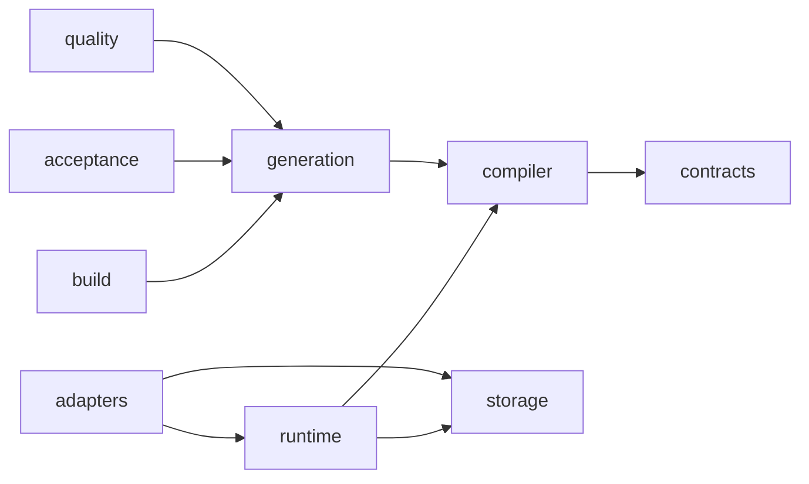

# 構成と依存方向

## 責務と依存方向

矢印は依存を許す主要な方向です。内側からadapters・generation等への逆依存は[構成テスト](../tests/architecture/test_dependencies.py)で拒否します。共通のJSON・ハッシュ・表示処理は `_internal/` に置きます。テストの配置はソースと対応し、業務別の受入テストは `tests/apps/` に置きます。

## 公開APIと生成API

宣言・契約は `myworkflow`、コンパイルは `compiler`、実行は `runtime`、保存契約は `storage`、具体実装は `adapters` から利用します。`myworkflow.executable` は既存の公開入口です。生成は `generation`、ビルドは `build` に置き、Programは文書生成へ依存しません。

[注釈](annotations.md)の共通入口は `__myworkflow__` です。Python宣言はオブジェクト参照、コンパイル後のモデルは固定IDで接続します。内部モデルのアクセスは属性へ統一し、辞書形式は読込み・書出しの境界で扱います。`Program.spec` は独立した互換スナップショットで、変更しても契約は変わりません。`Catalog` は `ContractCatalog` の互換名です。

EngineはExecutionStore・LockProviderを受け取ります。業務DBや特定アプリのSQLを直接呼びません。保存の保証と復旧判断は[実行保証](execution-design.md)、[確定境界](artifact-jobs.md)、[遷移実行](transition-execution.md)に集約しています。
