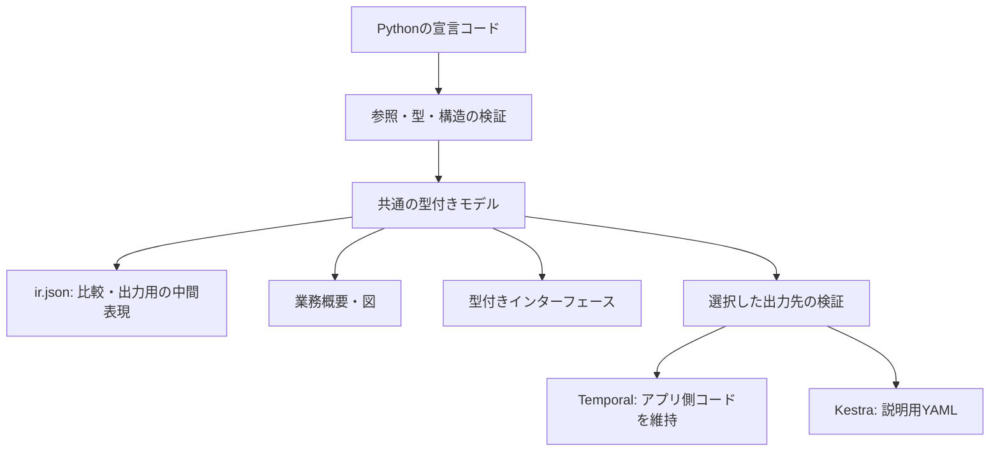

# 宣言の正本・中間表現・ビルド

## 正本はPython

購買の正本は `examples/purchase/contract.py` のPython宣言である。ワークフローは `@workflow` のクラス、パイプラインは `PipelineDeclaration`、処理は `Action`、排他は `Mutex`、補償処理の識別は `Operation` で表す。

入力・成果物・ステップの参照／更新・条件・補償はオブジェクト参照で接続する。ハンドラーは `@registry.implements(c.save_quote_a)` のように宣言を参照し、コンテキストの項目も `c.quote_a.key` のように参照する。実行APIは配置・トリガー・パイプラインの宣言参照を受け取り、境界で固定IDへ変換する。

固定ID、外部から渡される項目名、抽象ロール枠、DB上の業務状態値などは契約のデータであり、Pythonの識別子とは別に保つ。Gherkin等の外部仕様で固定IDを使う運用も維持する。

`SPEC = program.spec` は読み取り互換のために生成する独立した辞書スナップショットで、手書きの正本ではない。アプリケーションは `contract.program` を使用する。旧辞書入力は入力互換として残すが、購買の業務定義を二重に手書きしない。

状態がまだ宣言されていないワークフローのために、ビルドで状態や順序を推測して補わない。状態宣言なしのクラスもコンパイルできる。状態を宣言した場合は従来通り初期状態・参照・到達性を検査する。

## コマンド

リポジトリ直下から、選択した一つの実行基盤向けに実行する。両基盤を並行運用する仕組みではない。

```sh
# Temporal固有のコード・マニフェストは生成せず、共通出力と接続検査を行う
python -m myworkflow build --config examples.purchase.build \
  --target temporal --output dist/temporal

# 現在対応する部分を明示してKestra向けの説明用YAMLを生成する
python -m myworkflow build --config examples.purchase.build \
  --target kestra --workflow w.attach --output dist/kestra

# 生成物の差分があれば失敗。書込みはしない
python -m myworkflow build --config examples.purchase.build \
  --target kestra --workflow w.attach --output dist/kestra --check
```

インストール後は同じ引数で `myworkflow build ...` とも実行できる。`python -m myworkflow.build ...` も同じCLIへの入口として残す。

利用側のビルド設定は、同じコンパイル済み宣言と実装レジストリを参照するだけでよい。

```python
from myworkflow.build import BuildConfig
from examples.purchase.contract import compiled
from examples.purchase.handlers import registry

BUILD = BuildConfig(compiled, registry)
```

モジュールのimportは通常のPythonとして実行される。ビルダー自身は、宣言発見のために業務ハンドラーを実行したり、外部システムを呼んだり、配備したりしない。

## 共通の中間表現



内部では型付きContractCatalogとStateGraphを使う。`ir.json` はそれを出力した生成物であり、開発者が直接編集するDSLではない。形式は `schema_version=1`、中に業務要件形式v2、宣言された状態グラフ、固定IDと実装関数の対応を含む。

| 生成物 | 内容 |
| --- | --- |
| `ir.json` | 業務構造、終了結果の共通契約、実装関数への対応、宣言された状態グラフ |
| `requirements.md` | 選択した業務概要と実装対応。状態宣言があれば図と遷移表も含む |
| `interfaces.py` | リクエスト型と共通PipelineResultの別名 |
| `data-definitions.md` / `data-definitions.json` | ValueObject宣言がある場合の別ファイルのデータ定義。業務要件から参照する |
| `build.json` | 出力先・選択範囲・各生成物のSHA256 |
| `manifest.yaml` | Kestra選択時だけ生成するプレビュー |

出力は時刻や絶対パスを含めず決定的に生成する。固定出力との一致と再生成後の `--check` をCIで検証する。手書きの契約・実装ファイルは生成対象に含めず、既知のソースへ上書きする場合は拒否する。

`--workflow` は明示的な部分ビルドで、複数指定できる。未選択の引継ぎ先がある場合は失敗する。省略時は全てを対象にする。手書きオーケストレーションの全呼出しを解析して依存を推測する機能ではない。

## Kestraの対応範囲

今回の合意に合わせ、[プレビューの例](../examples/purchase/kestra-attachment.yaml)は説明・レビュー用の独自YAMLとした。実際のKestra Flow定義ではなく、そのまま配備・実行できない。`deployable: false`、形式名、CLIの出力でこの境界を明示する。

配置・トリガーごとに、操作ロール、入力対応、Pythonパイプラインの呼出し先を列挙する。`ir.json` から処理・補償・実装関数を確認できる。ステップ内の条件分岐・再試行・補償は既存Python Engineの責務であり、Kestraのネイティブタスクへ変換したものではない。

| 宣言 | 現在の扱い |
| --- | --- |
| Pythonパイプラインの呼出し・入力対応・ロール | プレビューへ出力 |
| `Trigger.wait` | ビルド失敗 |
| `Trigger.after` | ビルド失敗 |
| `Binding.next_workflow` | ビルド失敗 |
| 状態グラフ | 実行への変換が未実装なのでビルド失敗 |
| 未知の `required_features` | ビルド失敗。現在は `python_pipeline` のみ対応 |
| 実装未接続、参照不正、型・データフロー不整合 | ビルド失敗 |

これらがKestra自体で不可能だという判定ではない。今回の変換器が対応していないという判定であり、黙って省略しない。

購買全体を `--target kestra` でビルドすると、承認待ち・日時待ち・次ワークフロー起動の固定IDを示して失敗する。`--workflow w.attach` はこれらを含まない範囲を利用者が明示した場合の成功例である。全体が対応済みになったという意味ではない。

## Temporalの対応範囲

Temporal固有のコードはアプリ側の手書き実装を維持する。ビルドは共通モデル、実装接続、選択した範囲を検査し、共通出力を生成する。状態宣言からTemporal Workflowを自動生成したり、既存コードの待機・再生・冪等性を静的に証明したりしない。ビルド自体にTemporal SDKは不要。

出力先を変更しても手書きコードを上書き・削除しない。KestraのマニフェストがあるディレクトリをTemporal用に再利用すると、古いマニフェストの混入を防ぐため失敗させる。

## 残課題

今回、購買の正本と参照の整理、中間表現の出力、ビルド、Kestraの説明用YAML、未対応宣言のビルド失敗までを対応した。以下は未完了のまま残す。

- 複数グラフや外部副作用を含む実行、業務状態の失敗・補償・結果不明時の方針。単一レコードのガード・遷移選択と確定は、[ローカルEngine](transition-execution.md)へ実装済み。
- 同じ状態宣言から実行基盤を動かす変換、フロー全体の自動再開。
- KestraネイティブのFlow生成、実行アダプター、実機での配備・待機・再開・障害検証。
- 共通Providerの本番向けの共有保存先、分散排他、認証、中間サーバーへの通信実装。
- 外部DB・S3・メール等を含む確定と復旧、保持期限・GC・容量管理。
- 顧客レビューと工数・トークン削減の実測、GitHub Actionsの結果確認。

ローカルProviderの準備・確定と限定したTemporal実験は既存の到達点として維持する。今回のビルド成功を、これら未実装項目の達成へ読み替えない。

[バリューオブジェクト](value-objects.md)はPydanticモデルを正本とし、IRにSchemaと実装参照を含める。生成Requestは同じモデルを参照する。独自バリデーターをSchemaから復元する処理は行わない。
