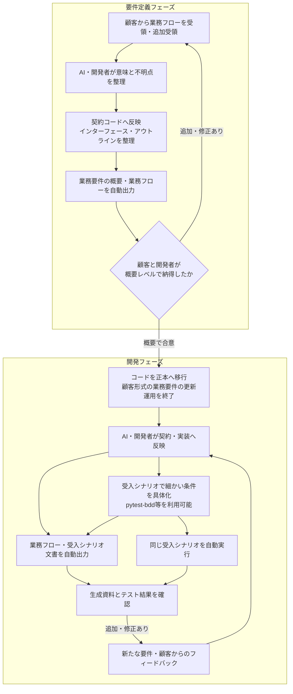

# 要件定義から開発までの工程

要件定義では、顧客から追加・修正された業務フローを繰り返し受け取り、契約コードと生成概要で合意します。処理本体の完成前でも、インターフェース・アウトラインを整理し、未決事項を明示します。

合意後はコードとfeatureを正本とし、顧客形式の資料への追従更新を終了します。新しい要件の受領は継続し、AI・開発者が契約・実装・シナリオへ反映します。顧客は生成した概要・業務図・受入仕様を確認します。

| AI・開発者が更新する正本 | 自動生成・実行するもの |
| --- | --- |
| 業務契約のPython宣言 | 型・インターフェース、業務概要・図 |
| 処理・操作・検証関数 | 同じ契約に接続した処理実行 |
| 受入条件のGherkin | 受入仕様とpytest-bddの実行結果 |

契約から導ける型・名前・接続は自動検査し、業務上の期待結果は独立した照会で確かめます。期待値を実装に合わせて自動修正しません。[受入方式の判断](acceptance-evaluation.md)と[合格基準・残課題](poc-plan.md)。
