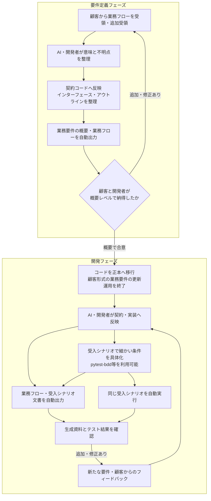

# 要件定義から開発までの工程

## 要件定義フェーズ

顧客から受け取った業務フローをAI・開発者が繰り返しコードへ反映し、そこから業務要件の概要・業務フローを出力する。顧客と開発者が概要レベルで納得するまで、追加・修正された業務フローを取り込み続ける。

この段階では、具体的な業務処理をすべて実装する必要はない。ワークフロー、配置、パイプライン、ステップ、ロール、アーティファクト、入出力のインターフェースとアウトラインを整理する。未決事項と未実装部分は明示する。

## 開発フェーズ

顧客形式の業務要件を別の正本として更新する運用は廃止する。顧客が基本的に確認するのは、コードから出力した業務フローと概要である。従来の資料は必要なら履歴・受領記録として保管するが、現行コードへの追従更新はしない。新しい依頼を自然言語や顧客の資料で受け取ることを禁止するものではない。

新しい要件は基本的に契約コードと実装へ反映する。具体的な正常系・分岐・境界条件・異常系は受入シナリオへ追加し、コードと固定IDで関連付ける。pytest-bddなどで書いたシナリオも、顧客が見やすい文書への出力対象とする。業務フローが全体像、受入シナリオが具体的な条件、実装が処理の詳細を担う。

顧客の指摘をどの定義・シナリオ・実装へ反映するかはAI・開発者が判断する。必要に応じてその都度スキルを使って整理してよい。特定のスキルを実行や生成の必須条件にはしない。文書を表示するだけでコードや期待値を自動変更しない。

## 手書きと自動生成の境界

| 対象 | 作成・更新の方法 | 正本か |
| --- | --- | --- |
| 契約コード | AI・開発者が業務の意図を反映 | 正本 |
| 処理実装・操作・検証関数 | AI・開発者が記述 | 正本 |
| 受入シナリオ | AI・開発者が期待結果を定義。pytest-bddのfeature等も候補 | 正本 |
| 型・インターフェース | 契約コードから自動生成 | 生成物 |
| 業務フロー・概要 | 契約コードから自動生成 | 生成物 |
| 読みやすい受入シナリオ文書 | シナリオの正本から自動生成 | 生成物 |
| テスト結果・対応・網羅状況 | シナリオ実行と検査から自動出力 | 実行結果 |

シナリオは、Python宣言とGherkinのどちらを正本とするかをPoCで決める。同じシナリオを両方に手書きしない。Gherkinを正本にする場合もソース管理し、業務契約とは固定IDで結ぶ。pytest-bddのテスト文を機械的に仕様から推測できるとは扱わない。

## 自動化で確かめること

契約から導ける型・名前・接続は自動生成・整合性検査する。業務上期待する結果はシナリオで明示し、独立した照会などで検証する。テストに合わせて期待値を自動修正しない。

出力差分は変更の説明として使い、実行試験で振る舞いも確認する。合格・失敗・未実行・未実装を区別し、対象の固定IDへ辿れるようにする。詳細な状態遷移や補償手順は別文書・実装に整理してよい。

この文書は工程の方針である。既存の契約実行・概要生成は実装済みだが、共通の受入シナリオ定義から文書とテストを生成・実行する機能はまだ未実装。[受入テストのタスク](acceptance-plan.md)で進める。
