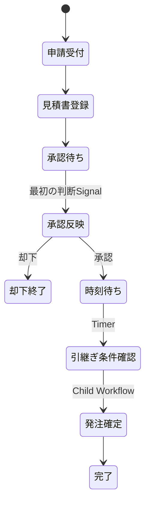

# 実行設計と保証範囲

## 正本と生成物

| 役割 | ファイル |
| --- | --- |
| 初期要件と解釈結果の記録 | requirements/purchase.md、purchase-initial.json |
| 移行後の契約の正本 | examples/purchase/contract.py |
| 再生成できる型 | examples/purchase/interfaces.py |
| 手書きの実装 | examples/purchase/handlers.py、services.py |
| コードから生成する概要・実装対応表 | examples/purchase/requirements.md |
| 詳細な待機・遷移の実装 | examples/purchase/temporal_workflow.py |

型・順序・分岐・起動先は契約から取得します。実装の関数を固定IDで登録し、文書にはモジュールと関数名を出します。`Program.check` が未接続を検出します。生成関数のdocstringを別の正本にはしません。

初期生成は空のディレクトリにのみ行います。移行後の更新は契約コードを編集し、`scaffold interfaces` で型だけ再生成します。`handlers.py` は上書きしません。概要文そのものの正確さはレビュー対象です。

## パイプライン

終了結果は [PipelineResultの契約](pipeline-results.md) に統一した。業務データは戻り値へ含めない。

`Engine.invoke` は起動定義の入力元を変換し、信頼された受付が渡した `Principal` のロールを確認します。`Engine.run_internal`（旧 `run` は互換名）は内部向けの低水準APIで、受付認可を行いません。`invoke_or_raise` と `run_or_raise` は例外伝播を必要とする接続用です。未信頼の入力から呼び出してはいけません。

リクエストdataclassのフィールドと型、およびレスポンスが共通PipelineResultであることをEngine作成時に検査します。受付時・各処理の前後で必須フィールドと値の型を検査し、boolをintとして受理しません。ステップのコンテキスト読書きは宣言範囲へ限定します。サービス内部のSQLや外部I/Oまで静的に解析するものではなく、副作用は機能試験で確認します。

型はstr・int・bool・floatのフラットな項目に限定しています。ネストや任意型、並列ステップ、循環グラフは対象外です。分岐は利用可能なboolに対するTrue／Falseの条件で、非選択処理をスキップして順次合流します。両経路で生成された項目だけを無条件の出力として認めます。欠落した分岐、順序を変えたことによる未生成情報の参照を検出します。

## 購買実装と排他

SQLiteの申請・添付・発注テーブルを使います。発注作成と状態更新は同一トランザクションで行い、発注挿入後に障害を入れた試験で両方のロールバックを確認します。申請者と承認者の別人確認、申請者本人による添付、起動ロールを検査します。

排他は共有されたInProcessLockProvider内のスレッドロックです。Servicesが別でも同じProviderを渡せば共有できます。パイプラインをまたいで申請IDのキーを共用し、競合を拒否し、例外時も解放します。分散ロックではありません。発注の最終条件はDBトランザクション内で再確認し、application_idの一意制約で重複発注を防ぎます。複数Worker／プロセス間の全操作の整合性は未保証です。

Principalの認証、ロールの外部照合、ファイル形式・サイズ検査、実組織の権限取得は未実装です。Temporalの起動・Signalを直接公開せず、認証した受付でPrincipalを構築する必要があります。

## S3相当の補償

保存アダプタはファイル実体とSQLiteのobjects・intentsメタデータでS3相当の操作をモデル化します。blob本文はDBへ格納しません。実S3 APIとの互換性・AWS権限・バージョニング設定は検証していません。

1. 実行ID・スロットA/Bごとの保存先と期待バージョンを、保存より先にintentsテーブルへ記録する。
2. 実行専用キーで作成する。再試行は同じ所有者・バージョン・本文だけを再利用し、上書きしない。
3. 一時障害は契約に従って最大2回試行する。
4. 最終失敗時は、失敗した処理も含めB→Aの順で補償する。応答消失による曖昧な成功も対象にするため、補償を正処理の前に登録する。
5. 削除時は期待する所有者・バージョンを照合する。他の実行による置換を検出したら削除せず、補償失敗を残す。
6. 補償失敗時はrunsテーブルへmanual-recoveryを記録する。プロセスを開き直して `Services.recover(run_id)` を実行できる。繰返し削除しても他の物は消さない。

同じ実行IDの再利用は拒否します。成功した実行に対するrecoverも拒否します。補償は一時的な部分完了を隠しません。申請そのものなど、補償宣言のない副作用は取り消しません。

突然の停止では実行がrunningのまま残り得ます。停止済みと運用者が確認した場合のみ `recover(run_id, interrupted=True)` でintentを照合できます。自動的なクラッシュ検知、実行中処理との競合回避、キャンセル時の自動補償、復旧処理そのもののリトライ管理は未実装です。

## Temporalの遷移

`w.approval` は申請・添付・承認の各パイプラインを共通Activity経由で呼び、`b.dispatch.next_workflow` に指定した `w.execution` を起動します。子ワークフローも同じEngineで `b.confirm` を実行します。実行結果はSQLiteに残ります。手動開始はローカルEngineの `t.manual` で使えますが、Temporalの別の受付としてはまだ実装していません。

Activityの再試行は1回に限定し、パイプライン内で宣言した一時障害の再試行だけを行います。外部副作用があるActivityの無条件再実行は安全ではありません。Activity完了通知の消失やActivity途中のWorker停止の完全復旧は未対応です。失敗Activityの自動再試行・長期履歴のバージョン管理は次段階です。

承認待ちでWorkerを停止・再作成し、履歴の再生後に再開する試験を実施しています。重複Signalは最初の判断を採用します。権限のない最初のSignalはActivityで失敗し、業務は進めません。後から別Signalを送ってその失敗を自動回復する機能はありません。Temporalサーバー自身の再起動、承認期限切れ、Activity途中の停止は未検証です。

## モジュールと基盤の分離

[現在の構成](architecture.md)に、共通モデル・Protocol・保存アダプタ・補償・受入プラグインの責任と移行方法を記載しています。同期の業務実行はTemporal Activityから別スレッドで呼び出し、SDKのイベントループをブロックしません。
