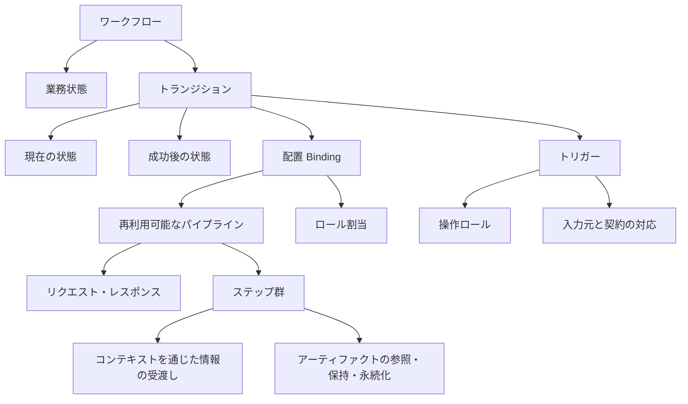
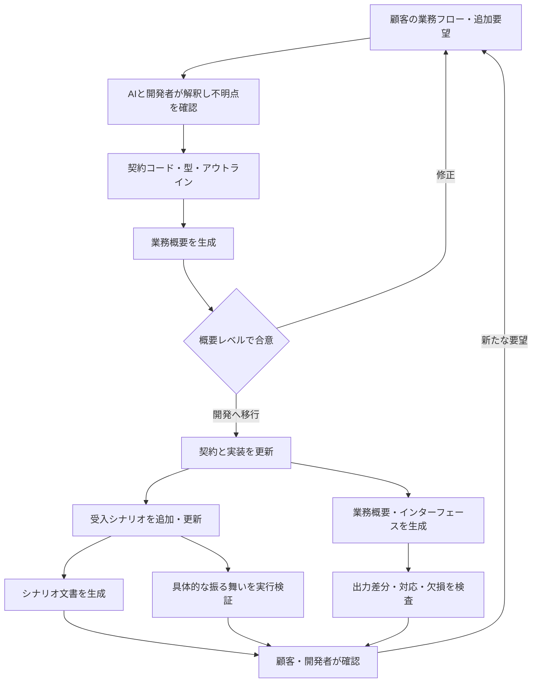
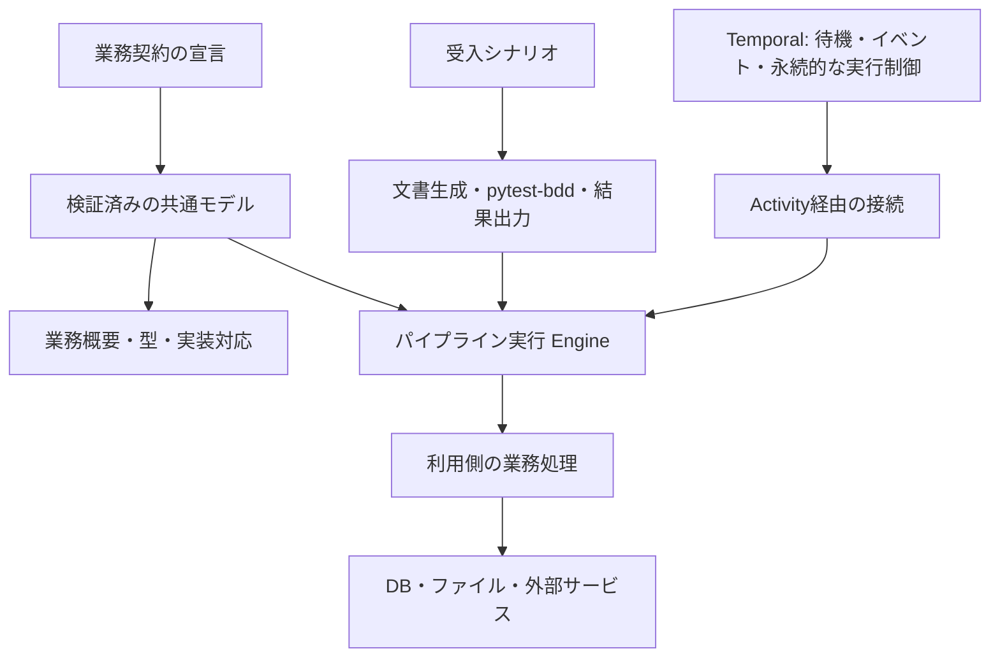

# myworkflowのプロダクト概念

## 提供する価値

myworkflowは、Pythonで記述した業務契約から、顧客が確認する業務概要、型付きインターフェース、実装の骨格、実装への対応表を生成し、受入シナリオと合わせて変更の整合性を検査するライブラリである。

解決したいのは、要件書・インターフェース・実装・テストを別々に更新した結果、何が現在の仕様か分からなくなる問題である。開発者が更新するコードと、顧客が読む業務概要を同じ契約へ結び付ける。型や接続は自動で揃え、具体的な振る舞いは受入テストで確認する。

価値の中心は、要件変更を取り込んだ後も「業務概要のこの処理が、どの入力・実装・テストに対応するか」を維持することにある。フローを実行できることだけでは、既存製品との差別化にはならない。[製品比較と事業上の評価](product-comparison.md)で検討する。

## 想定する利用者

- 顧客と対話しながら、業務システムをPythonで開発・保守するチーム。
- 業務分析者・顧客は、生成された概要と受入シナリオを読み、業務上の意図を確認する。
- 開発者は、契約・実装・シナリオをソース管理し、変更差分とテスト結果を確認する。

特に、申請、承認、差戻し、添付、日時指定、確定などを含む個別業務アプリケーションを想定する。顧客自身がコードを書けることは前提にしない。一方、現在は開発者が契約を作成する必要があり、非開発者だけで画面から構築できる製品ではない。

## コードファーストの意味

「コード」は、業務契約を表す宣言と、実処理の実装を含む。任意の関数の内部を解析して、業務要件の意味を自動発見するという意味ではない。

業務名、処理概要、ロール、入出力、アーティファクト操作などは、開発者が宣言へ明示する。型・参照・順序は機械的に扱え、概要文は顧客向けの説明となる。docstringやアノテーションも情報を持たせる候補だが、現実装の中心は宣言オブジェクトである。

宣言に書かれたこと、処理として実装されたこと、テストで確認されたことを区別する。概要文に「自己承認不可」と書いただけでは、その禁止を実行時に保証したことにはならない。

## 概念と責務

| 概念 | 意味・責務 |
| --- | --- |
| ワークフロー | 顧客にとって意味のある業務のまとまり。複数のパイプライン、人の操作、イベントや待機を含む |
| パイプライン | APIやバックグラウンドジョブなど、入出力契約と処理単位を持つ再利用可能な処理 |
| ステップ | パイプライン内の処理単位。コンテキストに含まれる情報を参照・更新する |
| 配置（Binding） | ワークフロー内でパイプラインを使う場所。起動経路やロール割当を結び付ける。同じパイプラインを別の配置で流用できる |
| トリガー | 操作、イベント、時刻到達など、処理を開始・再開する契機。リクエストのデータそのものとは別 |
| リクエスト／レスポンス | 入力は業務情報、戻り値は終了コード・重大度付きメッセージ。業務データの成果物はアーティファクトとして別に扱う |
| アーティファクト | 申請情報、ファイル、識別子など、処理で扱う情報。境界の入出力に現れる場合も、処理中だけ参照・保持・永続化する場合もある |
| ロール | 操作・処理を担当する立場。業務上の正式名と概要で使う表示名を区別する |
| 状態 | 承認待ち、修正待ち、承認済みなど、業務対象の状況 |
| トランジション | 現在の状態から成功後の状態へ移る業務上の操作。状態・配置・トリガー・条件を結び付ける |
| 排他 | コンテキストからキーを参照し、競合する処理を制限する。概要へ出せる処理単位として扱う |
| 受入シナリオ | 与えられた前提で、操作・経過時間・障害などに対して何が起きるべきかを具体化する |

ワークフローは人同士の連絡も含めて説明する概念である。ただし、システムが観測できない会話を自動実行・検証できるとは扱わない。人の操作、受信イベント、確認記録などの境界を設け、説明に留まる範囲を明らかにする。

## 宣言上のつながり

具体的な業務状態は、パイプラインの配置を参照する遷移側に置く。パイプラインそのものへ特定のワークフローの状態を埋め込まず、再利用を保つ。

状態遷移のグラフは循環を許す。差戻しから再申請して承認待ちに戻ることは業務の遷移であり、一時的な通信障害の再試行とは別である。パイプライン内のステップは現在、条件付きの順次実行を扱う。

## 入出力とコンテキスト

パイプラインがリクエストを受け取り、契約に従ってコンテキストへ渡す。ステップが個別にHTTPリクエストを受け取る構造にはしない。戻り値は共通の `PipelineResult` とし、業務データをレスポンスへ混ぜない。[終了結果の契約](pipeline-results.md)を参照。

業務概要には、受付と返却を表示用の行として生成する。受付は0番目、返却は最後の行として示すが、そのために同じ数の実装関数が必要になるわけではない。リクエストとレスポンスは「入出力」列に入力・出力の注釈を付けて表示する。

過程で扱う情報は別の列で、参照・保持・DB読取・DB作成・DB更新・送信などとして示す。排他キーも、既にコンテキストにある情報の参照と、ロックの保持として扱う。アーティファクトの記載だけでSQLや外部サービスの副作用まで自動検証できるものではない。

## 正本と生成物

| 対象 | 役割 |
| --- | --- |
| 契約コード | 業務の表層構造、型、接続、概要を表す正本 |
| 処理実装 | 判定、永続化、外部I/O、補償などの詳細を表す正本 |
| Gherkinの受入シナリオ・検証関数 | 具体的な前提・操作・期待結果を表す正本 |
| 型・実装骨格 | 契約から生成。骨格の未実装部分は未実装として扱う |
| 業務概要・型一覧・実装対応表 | 契約コードからの生成物 |
| 受入シナリオ文書 | 同じGherkinからの生成物 |
| 品質レポート・実行結果 | 検査の結果。成功・失敗・未実行・既知の欠落を区別する |

契約、処理、期待結果はそれぞれ異なる情報を担う。テストの期待結果を実装の現在の出力から自動更新して、一致したことを正しさの根拠にはしない。

## 利用する工程

要件定義では顧客の資料を繰り返し取り込み、概要で対話する。開発移行後は生成した業務概要を基本の確認資料とし、顧客形式の要件書を並行して追従更新する運用を終える。元資料は受領記録や固定した回帰評価用のコーパスとして残せる。

自然言語から契約を作る作業は、現在はAI・開発者による解釈である。インターフェース生成や出力比較は自動化するが、自然言語の意味の正しさや期待結果の変更にはレビューが必要になる。[工程の詳細](development-process.md)を参照。

## 出力の読み方

業務概要はワークフロー・パイプラインごとに区切り、ステップ表へ連番、トリガー、実行者、ステップ名、処理概要、入出力、アーティファクト操作、固定IDを出す。同じ配置への複数トリガーは受付行を分ける。

状態遷移表は別に、次の順序で表示する。

連番 → ワークフロー → トランジション → 実行者 → トリガー → **現在の状態 → 成功後の状態** → 条件 → パイプライン → 固定ID。

例えば「承認」は、承認者が承認操作を契機に、承認待ちから承認済みへ移すトランジションである。条件や対応するパイプラインを同じ行で確認する。実行中インスタンスの現在値や履歴を表示した表とは区別する。

連番は読みやすい順序の表示、固定IDは履歴・差分・対応の追跡に使う。Pythonの属性名・変数名を変更しても、同じ業務要素なら固定IDを維持する。[クラス宣言と生成例](../examples/declarative_review.md)を参照。

## 実行基盤との関係

ローカルEngineは契約とハンドラを結ぶ。長期待機や履歴に基づく再開はTemporalなど既存基盤へ委ねる方向である。現在のTemporalサンプルの制御は手書きで、新しいクラス宣言・状態グラフから自動構築する機能は未実装である。

業務上の状態と、処理のrunning・completed・failed・manual-recoveryなどの実行状態も区別する。補償失敗の記録があっても、業務状態の整合した更新まで自動で保証したことにはならない。

## 現在できることと未完了部分

| 範囲 | 現在の到達点 | 残る境界 |
| --- | --- | --- |
| 契約と文書 | 同じモデルから概要・型・骨格・実装対応を生成 | 自然言語の意味は人が確認 |
| クラス宣言 | オブジェクト参照、配置、複数トリガー、状態・遷移をコンパイル | 購買の正本をクラス形式へ移行済み。構文の安定化は継続 |
| リファクタリング | ワークフロー・パイプライン・ステップ・補償のPython参照を使い、識別子変更後も固定ID・出力が一致 | 外部の項目名・固定ID等は契約のデータとして維持する |
| 実行 | 型・読書き・ロール・条件付き順次実行・再試行・補償を検査 | 基本型とPydanticのJSONデータ契約、限定した保存アダプタ・プロセス内ロック |
| 状態グラフ | 循環の参照・到達性検査と表出力。ローカルEngineでガード・遷移選択と状態を含む一括確定 | 同じ宣言からのTemporal接続、外部副作用を含む確定は未実装 |
| 受入テスト | サンプル業務のGherkinを文書化・pytest-bddで実行 | 期待結果と操作・検証関数は人・AIが記述 |
| 往復品質 | 固定要件 → 骨格 → 再出力・型の比較、欠損レポート | 現在の変換器は固定サンプル。新しい状態宣言は従来の往復指標に未統合 |
| 利用画面 | Markdownの概要・シナリオと、状態宣言からMermaidの業務フロー図を生成 | フロー編集UI、承認画面、運用画面は未実装 |

終了結果の更新を明示した現行の購買評価では、構造322項目の往復一致に対し、更新した回帰入力24要件のうち構造化は10件、概要文のみ11件、未表現3件である。記載充足率87.50%は意味の完全一致や実行保証を表す数字ではない。[定義と限界](requirements-quality.md)を参照。

## プロダクトとして守る境界

概要だけから実装全体を完全復元することは目標にしない。表層の契約を対応させ、詳細は実装・受入シナリオ・状態や復旧の文書へ整理する。全てのテストを概要から自動推測することも目標にしない。

今後の中心は、表層契約の対応範囲を増やし、変更による不整合を検出することである。独自の汎用実行基盤や大量のSaaSコネクタを作ることは優先しない。状態宣言からの[読み取り用の図](../examples/declarative_review-flow.md)を追加した。顧客による読みやすさは未評価であり、編集UIを追加する場合も、自由なPython編集とUI編集を無制限に往復できるとは約束しない。

## ビルドによる生成

Python宣言を正本とした[ビルド](build.md)を追加した。中間表現・概要・型を共通出力とし、Kestraは説明用YAML、Temporalは既存コードを維持する。対応しない制御を黙って落とさず失敗させる。Kestraでの実配備・実行は未実装。

[バリューオブジェクト](value-objects.md)の制約は業務概要とは別のデータ定義へ出力する。境界で値を検証し、実装の全変数でモデルクラスを使うことは強制しない。
