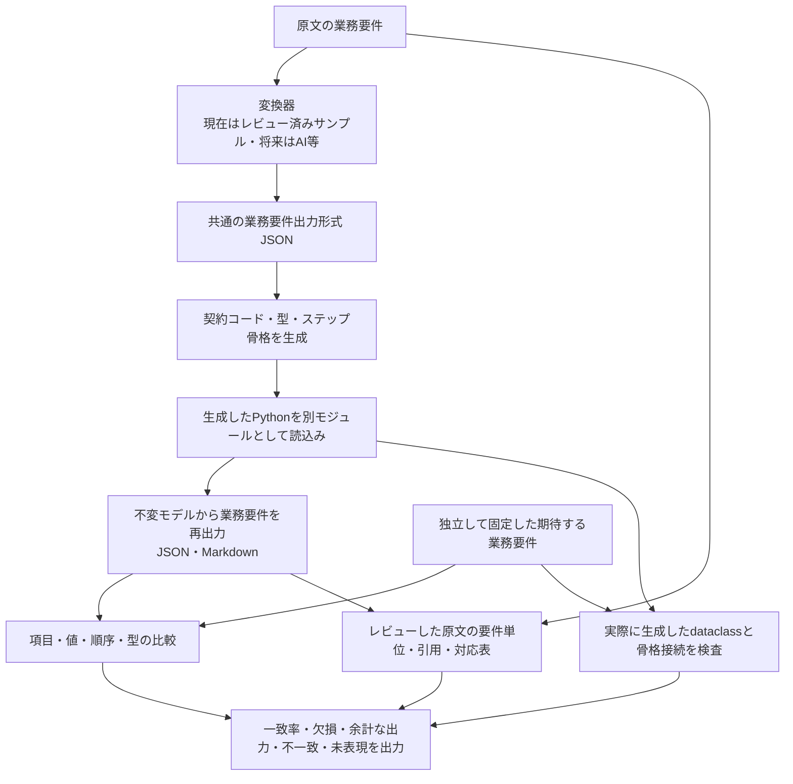

# 元要件から生成コード・再出力までの継続品質検査

## 検査する流れ



初期サンプルの変換器は、用意した変換結果を読み込むだけで、自然言語を理解する処理ではない。今回は変換結果と期待入力に同じレビュー済みJSONを指定しており、変換一致率100%はこの固定サンプルの基準値である。AIの理解精度を100%と報告するものではない。

外部の変換候補を比較するときは `run_case(case_path, converter=...)` に `converter(source_text) -> business_document` を渡す。候補に正解の業務要件や要件棚卸し表を引数として渡さない。AIの応答の揺れ、モデル・プロンプト・設定の記録や複数回評価は、その変換器を実装する段階で追加する。

## 実行

Python 3.14とプロジェクトの標準依存（Pydantic）をインストールし、リポジトリ直下から実行できる。

```sh
python -m myworkflow.quality \
  --case examples/purchase/quality/case.json \
  --output artifacts/requirement-roundtrip
```

出力はquality.json、quality.md、変換前後・再出力の業務要件JSON、再出力Markdown、生成したcontract.py・interfaces.py・handlers.py。基準に達しなければ、失敗レポートを保存して終了コード1を返す。生成や読込みが失敗した段階はfailed、続きはnot-runとし、未実行の一致率を100%にしない。

[現在のレポート例](../examples/purchase/quality/quality-example.md)を用意している。

## 入力と正解を固定する

| ファイル | 役割 |
| --- | --- |
| docs/requirements/purchase-completion.md | 共通終了結果への変更を明示した回帰入力 |
| examples/purchase/quality/business-input.json | レビュー済みの、期待する業務要件出力形式 |
| examples/purchase/quality/business-expected.md | 顧客向けの表示形式の期待値 |
| examples/purchase/quality/coverage.json | 原文の引用、要件ID、表現箇所・値、既知の未表現 |
| examples/purchase/quality/case.json | 対象ファイルと合格基準 |

期待値はテスト中に生成し直さない。JSONのサンプルは既存のレビュー済み初期要件を元に一度準備したもので、検査対象のexporterから都度作るものではない。初期要件の記録は現行業務の別の正本として更新するのではなく、回帰用の固定コーパスとして残す。

出力形式は、固定IDをキーにしたロール・アーティファクト・パイプライン・ステップ・ワークフロー・配置・トリガーのJSONである。形式v2では共通のcompletion契約を持ち、パイプラインに入力・成果アーティファクト（produces）とインターフェース名、ステップに順序・参照・保持・補償などを持つ。人向けには従来の概要表へ描画する。

毎回一時ディレクトリに新しい骨格を生成して基盤の品質を調べる。既存アプリケーションの手書き実装を再生成・上書きせず、現行業務を初期の顧客資料へ固定するものでもない。新しい種類の要件を評価するときは、レビューした別の回帰ケースを追加する。

実際の再出力は生成コードの `Program.model` から構築し、Program.specや入力JSONをそのまま返さない。さらに、生成されたdataclassの項目・順序・実際の型注釈と、登録された骨格関数のIDを別に調べる。そのため、契約メタデータだけ正しく、interfaces.pyだけ誤っている場合も失敗する。

## 指標の定義

| 指標 | 計算・意味 |
| --- | --- |
| 変換の再現率 | 期待する入力の末端項目のうち、変換結果で値・型まで一致した割合 |
| 変換の適合率 | 変換結果の末端項目のうち、期待する入力と一致した割合 |
| コード再出力の再現率 | 期待する入力の末端項目のうち、生成コードから再出力して一致した割合 |
| コード再出力の適合率 | 再出力の末端項目のうち、期待する入力と一致した割合 |
| インターフェース | 期待するクラスの存在、項目名・順序・型の一致。余計なクラスも検出 |
| 原文の記載充足率 | 構造化または概要文で表現できた要件単位数 ÷ 全要件単位数 |
| 原文の構造化率 | 構造として表現できた要件単位数 ÷ 全要件単位数 |
| 原文の棚卸し範囲 | レビューした引用で覆った「業務」節の非空白文字数 ÷ 同節の全非空白文字数 |
| Markdown一致 | 保存した期待値との完全一致。文字列類似度は診断用で、意味の一致率ではない |

項目比較はIDに基づき、欠けた項目、余計な項目、同じ項目の値・型の不一致を分けて出す。処理順序のリストは順序も比較する。Trueと1は一致扱いにしない。空のリスト・オブジェクトも項目として扱う。

原文の判定は、レビューした要件単位ごとのチェックに基づく。

- structured：チェックが全て一致し、構造化項目で表現している。
- description_only：チェックは一致するが、少なくとも一部は概要文の表現である。
- missing：対応付けた項目・値が失われた、または変わった。
- unrepresented：現在の出力形式に対応付けがない。

説明文の判定は、レビュー済みの語句の存在確認であり、自然言語の意味的含意を自動証明していない。JSONでの表現と人向け表示を区別し、表示の欠落は独立したMarkdown一致検査でも検出する。

## 現在の結果

| 対象 | 結果 |
| --- | --- |
| 構造の往復 | 322項目中322項目一致、再現率・適合率とも100% |
| 生成インターフェース | 10インターフェース（入力型5件・共通終了結果の別名5件）で一致 |
| 原文の要件単位 | 全24件 |
| 構造化 | 10件（41.67%） |
| 概要文のみ | 11件 |
| 記載充足率 | 21/24件（87.50%） |
| 未表現 | 3件（12.50%） |

未表現は、今回の実行が所有する保存物だけを取り消す条件、他実行の保存物の保護、補償失敗時の手動復旧状態の宣言である。これらの動作は既存の実装・受入テストで扱っているが、現行の業務要件出力形式に独立した項目としては表現できていない。この違いをメトリクスで隠さない。

3件をレビュー済みの既知ギャップとして記録し、現在のCIは「この基準を満たす」ことを合格条件にしている。全要件を表現できたという判定ではなく、レポートでも「基準内（既知の未表現あり）」と表示する。新たな欠損や余計な出力を基準値へ自動的に取り込まない。

## 継続チェック

- 変換結果・生成コードのどちらで情報が失われたかを分ける。
- 原文のハッシュが変わったら、要件の棚卸しをレビューするまで採点を失敗させる。
- 要件単位を対応付けできなくても分母から除かない。
- 元の文を棚卸しから落として見かけの充足率を上げないよう、引用範囲も検査する。
- 未表現の許容リストと閾値は人がレビューして変更する。
- 検査設定・フレームワーク・生成コード・入力・棚卸し・期待表示のハッシュとコミット、未コミット変更の有無を残す。

CIには独立したrequirementsジョブを追加し、通常のテストが失敗しても品質レポートをArtifactで取得できる構成にした。ローカルでは成功を確認しているが、GitHub上の実行結果は未確認。

19件の検査で、補償の欠落、型の変更、余計な出力、順序変更、生成インターフェースだけの破損、骨格接続の欠落、生成失敗、原文変更、棚卸し漏れ、終了コードと入力保護を確認する。

この検査は表層の契約・表現力の検査であり、処理の実行結果を保証するものではない。正数判定、認可、待機、SQL・S3の副作用などは、既存の業務受入テストと併用する。人が決めた要件の分割や対応表自体が妥当かのレビューも引き続き必要である。

終了結果の変更前の原文は `requirements/purchase.md`、評価資料は `examples/purchase/quality/legacy-v1/` に保持する。形式v1は暗黙に読み替えず拒否する。分母が変わるため旧指標との単純な精度比較はしない。[変更の境界](pipeline-results.md)を参照。
