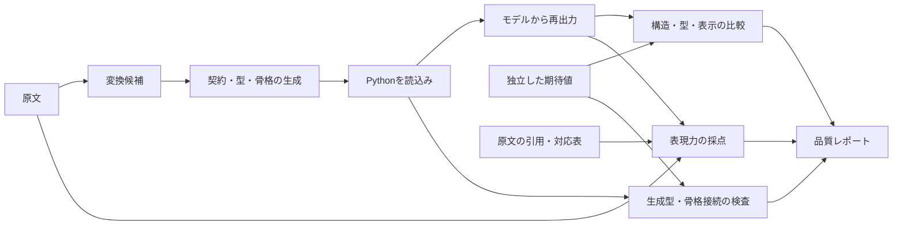

# 元要件からコード・再出力までの品質検査



## 実行と入力

```sh
python -m myworkflow.quality --case examples/apps/purchase/quality/case.json --output artifacts/requirement-roundtrip
```

[ケース設定](../examples/apps/purchase/quality/case.json)に原文・レビュー済みJSON・期待Markdown・要件棚卸し表・合格基準を指定します。入力・採点用期待値は固定し、検査中に再生成しません。現行業務の正本はPython宣言で、評価コーパスは回帰用です。新しい種類の要件は別のレビュー済みケースとして追加します。

現在の変換器は固定サンプルを読むだけです。変換一致100%はAIの理解精度ではありません。候補を試す場合は `run_case(case_path, converter=...)` へ `converter(source_text) -> business_document` を渡します。正解や対応表を候補に渡しません。モデル・プロンプトの記録と複数回評価は今後の変換器側の課題です。

一時ディレクトリに生成したPythonを読み、Program.modelから再出力します。入力JSONやspecをそのまま返さず、dataclassの項目・順序・実際の型とSchema、骨格の登録IDも独立して確認します。手書き実装は上書きしません。

## 指標

| 指標 | 意味 |
| --- | --- |
| 変換・再出力の再現率 | 期待する末端項目のうち値・型まで一致した割合 |
| 変換・再出力の適合率 | 出力した末端項目のうち期待値と一致した割合 |
| インターフェース | クラス・項目・順序・型・Schema・余計なクラスの検査 |
| 原文の記載充足率 | 構造化または概要文で表現した要件単位数 ÷ 全要件単位数 |
| 原文の構造化率 | 構造で表現した要件単位数 ÷ 全要件単位数 |
| 原文の棚卸し範囲 | 引用で覆った業務節の非空白文字数 ÷ 同節の全非空白文字数 |
| Markdown一致 | 独立した期待表示との完全一致。文字列類似度は診断用 |

IDで欠損・余計な項目・値や型の不一致を分け、リストの順序も比較します。Trueと1を区別し、空の配列・オブジェクトも一項目として扱います。

| 要件単位の判定 | 条件 |
| --- | --- |
| structured | 対応チェックが全一致し、構造化項目で表現 |
| description_only | 全一致するが、一部は概要文で表現 |
| missing | 対応項目・値が欠落または変化 |
| unrepresented | 出力形式への対応付けがない |

概要文はレビュー済み語句の存在確認で、意味的含意の証明ではありません。要件の分割・対応付け自体にも人のレビューが必要です。実行結果は[業務受入テスト](acceptance-evaluation.md)で別に検証します。

## 結果と基準の保護

現行の値と要件別の欠落は[品質レポート例](../examples/apps/purchase/quality/quality-example.md)へ集約します。既知の未表現3件は、保存物の所有範囲、他実行の保護、補償失敗時の手動復旧状態です。動作の試験があっても、独立した宣言項目で表現できたとはしません。

原文変更は棚卸しの再レビューまで失敗とし、対応不能な要件も分母から除きません。引用範囲・許容ギャップ・閾値を検査し、新しい欠損を自動で基準へ取り込みません。出力形式v1は拒否し、[旧評価](../examples/apps/purchase/quality/legacy-v1/)は履歴として保持します。分母の違う旧指標とは単純比較しません。

JSON・Markdownのレポート、変換前後・再出力のJSON、生成コードを保存します。基準未達は終了コード1、失敗段階はfailed、後続はnot-runとし、未実行を100%にしません。設定・原文・入力・棚卸し・表示・基盤・生成コードのハッシュ、コミットと変更有無も記録します。

[品質テスト](../tests/quality/)で型・順序・補償・余計な出力・生成型だけの破損・骨格未接続・生成失敗・原文変更・棚卸し漏れを注入します。CIは独立したrequirementsジョブでレポートを保存します。リモートCIの結果確認は[残課題](poc-plan.md)です。
