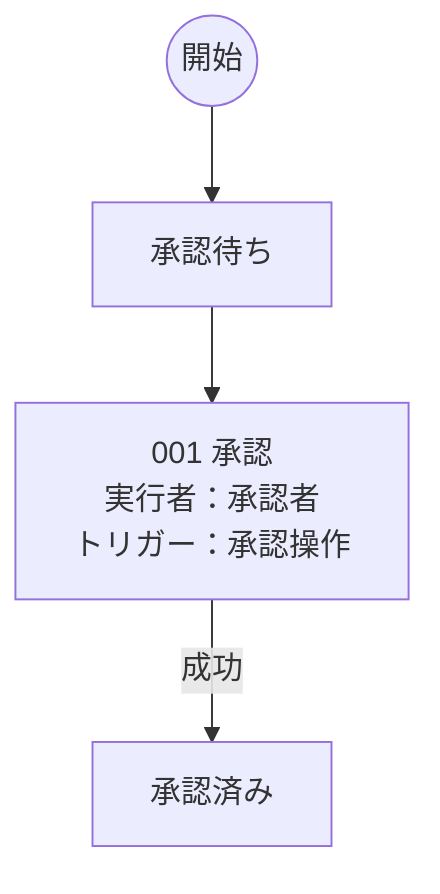

# 業務要件

## ロール一覧

| ロールID | 業務上の正式名 | 表示名 |
| --- | --- | --- |
| role.guarded_system | 業務システム | システム |
| role.guarded_reviewer | 審査責任者 | 承認者 |

## 001 トランジション契約に従う申請承認

### 001-00001 申請承認

| 連番 | トリガー | 実行者 | ステップ名 | 処理概要 | 入出力 | アーティファクト操作 | 固定ID |
| --- | --- | --- | --- | --- | --- | --- | --- |
| 001-00001-00000 | トリガー1：承認操作 | 承認者 | 受付 | 入力元：申請ID ← id | 入力：申請ID | — | w.guarded_approval/b.guarded_approve/p.guarded_approve/request |
| 001-00001-00001 | — | システム | 承認変更の作成 | 申請者本人の承認を拒否し、承認者と承認済みの状態を変更予定に記録する。 | — | — | w.guarded_approval/b.guarded_approve/p.guarded_approve/s.guarded_approve |
| 001-00001-00002 | — | システム | 結果返却 | 終了コードとメッセージを返す。 | 出力：終了コード・メッセージ | — | w.guarded_approval/b.guarded_approve/p.guarded_approve/response |

## 型付き契約

| 固定ID | 名前 | コード上のキー | Python型 |
| --- | --- | --- | --- |
| a.guarded_id | 申請ID | application_id | ApplicationId |

## データ定義への参照

詳細な制約は別ファイルの[データ定義](data-definitions.md)を参照。

| アーティファクト固定ID | データ定義固定ID |
| --- | --- |
| a.guarded_id | [vo.application_id](data-definitions.md#vo.application_id) |

## 起動定義の対応

| トリガー固定ID | 配置 | パイプライン | 許可ロール |
| --- | --- | --- | --- |
| t.guarded_approve | b.guarded_approve | p.guarded_approve | role.guarded_reviewer |

## 実装対応

| 固定ID | 実装 |
| --- | --- |
| s.guarded_approve | examples.guarded_approval.approve |

ロックはEngine → LockProvider、受付認可はEngine → Principal.rolesで実行。

# 業務フロー図

## トランジション契約に従う申請承認

操作の番号は状態遷移表の連番に対応します。入出力・アーティファクト操作はパイプラインの詳細表を参照してください。
条件・対応パイプラインは状態遷移表に記載します。
業務上の宣言を図示しており、実行履歴や状態更新の実装済み範囲を示す図ではありません。

# 状態遷移

| 連番 | ワークフロー | トランジション | 実行者 | トリガー | 現在の状態 | 成功後の状態 | 条件 | パイプライン | 固定ID |
| --- | --- | --- | --- | --- | --- | --- | --- | --- | --- |
| 001 | トランジション契約に従う申請承認 | 承認 | 承認者 | 承認操作 | 承認待ち | 承認済み | 申請者本人ではなく、金額が正である | 申請承認 | w.guarded_approval/tr.guarded_approve |
