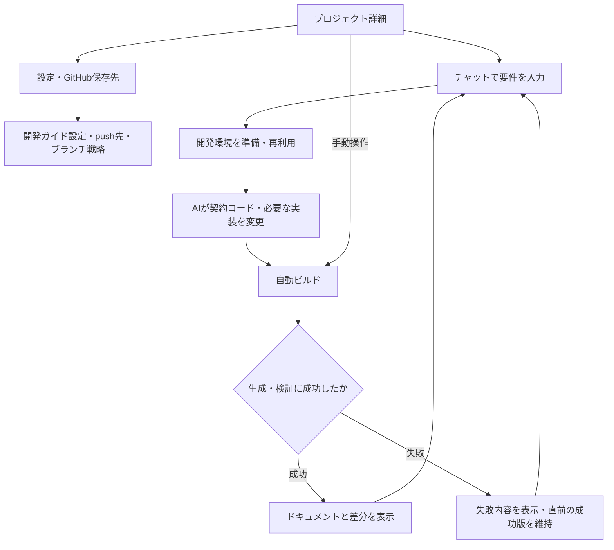

# myworkflow Webアプリの要件案

コードから、いつでも再現できる業務要件定義書。

myworkflow自身をWebアプリとして提供するための、自分開発用の要件定義。合意済みのアウトラインは[契約コード](contract.py)で宣言し、[ワークフロー一覧](docs/workflows.md)・[画面一覧](docs/screens.md)を自動生成する。本ファイルは受領した要件・設計案を残す手書きの入力資料であり、実装済み・自動生成済みの仕様ではない。「要求」は利用者から受け取った内容と合意済みの方針、「提案」「未決」は追加の検討事項とする。

親の構成はcontract.py、子の処理概要は[steps.py](steps.py)、共通のロール・データは[definitions.py](definitions.py)、画面と起動先は[screens.py](screens.py)に置く。処理本体は未実装であり、Registry・Engine・配備設定は持たせない。データの内部項目とバリューオブジェクトの制約は未決のため、今回は辞書型の入出力アウトラインまでを宣言する。要件IDは画面機能IDとステップの拡張属性で対応付ける。

## 中心となる業務

プロジェクト詳細画面で、利用者が対話で要件をコードへ反映し、ビルドして同じ版から生成した業務要件を確認する。設定・開発ガイドで、その開発の進め方を指定する。Webアプリの提供と、各プロジェクトで開発するアプリの本番公開は別の操作とし、後者は今回の範囲に含めない。

成功版の維持、会話から表示版までの追跡、自動プレビューと確定の分離は合意済み。環境再利用や検証の詳細方式は提案。自動ビルドは生成・検証とプレビュー作成を意味し、保存・マージは開発ガイドの戦略に従う別の操作とする。

| ワークフロー | 起点・実行者 | 概要・成果物 | 区分 |
| --- | --- | --- | --- |
| web.project.configure | 利用者が設定操作 | GitHub保存先と、push先・作業ブランチ戦略を開発ガイドに設定する | 要求 |
| web.requirements.update | 利用者がチャット送信 | 開発環境で要件をコードとドキュメントへ反映する | 要求 |
| web.documents.build | 要件反映完了、または利用者のビルド操作 | 同一のソース版からドキュメント一式を生成する | 要求 |
| web.documents.review | 利用者が詳細画面を開く | トップページからドキュメントを閲覧する | 要求 |

プロジェクト一覧・作成・削除と、独立した開発ガイドテンプレート管理は周辺機能として扱い、中心となる開発フローには含めない。機能要件とカタログ宣言は維持する。

## 画面と機能

| 要求ID | 画面 | 機能・期待する結果 |
| --- | --- | --- |
| WEB-001 | プロジェクト一覧 | プロジェクト一覧を表示する |
| WEB-002 | プロジェクト一覧 | プロジェクトを作成できる |
| WEB-003 | プロジェクト詳細 | 選択したプロジェクトの専用ページを表示する |
| WEB-004 | 設定 | プロジェクトの設定画面を持つ |
| WEB-005 | 設定 | 保存先にGitHubを指定できる |
| WEB-006 | プロジェクト詳細 | ドキュメントのトップページを表示する |
| WEB-007 | ドキュメント | プロジェクトのMkDocsサイトをそのまま閲覧する体験を目指す。表示方式は未決 |
| WEB-008 | チャット | 利用者が対話で要件を伝えられる |
| WEB-009 | チャット | 対話内容をコードへ反映し、対応するドキュメントを生成する |
| WEB-010 | チャット・実行状況 | Codespacesなどで開発環境を自動準備する。提供基盤は未決 |
| WEB-011 | プロジェクト詳細 | 手動ビルドボタンを持つ |
| WEB-012 | ビルド | チャットによる要件反映後に自動ビルドできる |
| WEB-013 | プロジェクト詳細 | プロジェクトを削除できる |
| WEB-014 | 開発ガイド設定 | プロジェクトごとに開発ガイドを設定する画面を持つ |
| WEB-015 | 開発ガイド設定 | push先と作業ブランチの切り方の戦略を設定する。選択肢・既定値は未決 |
| WEB-016 | 開発ガイドテンプレート管理 | プロジェクトの設定画面とは別に、開発ガイドテンプレートを管理する画面を持つ |
| WEB-017 | データ管理 | 業務契約はコードを正本とし、DBでは設定・会話・実行履歴を管理する。業務契約を二重管理しない |
| WEB-018 | ドキュメント・実行状況 | ビルド失敗時は最後の成功版を維持し、表示中のコミットと最新コードの版・差分を明示する。初回失敗なら未生成と表示する |
| WEB-019 | ビルド | 要件反映後に自動プレビューを作成する。ビルド成功だけを理由に保存・マージを確定しない |
| WEB-020 | チャット・変更履歴 | 会話からコード差分・検証結果・表示版を相互にたどれる |

### 開発ガイドとテンプレート

プロジェクト固有の開発方針は開発ガイド設定画面、共通の雛形は独立したテンプレート管理画面で扱う。push先・ブランチ戦略は開発ガイドの設定項目とする。

テンプレートの作成・編集・プロジェクトへの適用方法、設定の保存先、変更時に既存プロジェクトへ反映する範囲は未決。実行ジョブに適用した設定版を記録することを提案する。

## 正本と表示

コードが業務契約の正本、DBは設定・会話・実行履歴などの運用情報、という分担は合意済み。以下の具体的な保存先や表示方式は設計案。

### 未決の表示方式：「生成サイトをそのまま表示」とは

例えば「コード → myworkflowでMarkdownを生成 → MkDocsでHTMLサイトを生成 → Web画面から閲覧」という流れを指す。Webアプリ自身がMarkdownの表を読み解いて画面を組み直す方式ではなく、MkDocsが作ったページを表示する案。手書きの説明ページも含められる。

「機械処理用の契約データ」は、将来Webアプリがワークフロー一覧や固定ID検索などを独自画面で扱う場合のJSONなどを意味する。生成HTMLから業務構造を推測する代わりに、コードから直接出力する案であり、表示だけのために必須ではない。DBを業務契約の正本にする意味でもない。

この表示方式・機械処理用データの必要性は未合意。まずMkDocsサイトの閲覧で足りるか検証し、独自画面や検索が必要になった場合に追加を判断する。

| 管理対象 | 保存先の案 | 役割 |
| --- | --- | --- |
| 契約コード・実装・受入シナリオ・MkDocs設定 | GitHub | 再生成できる仕様の正本 |
| プロジェクト設定・GitHub接続・チャット履歴・ジョブ状態 | アプリDB | 運用情報。業務契約の別正本にはしない |
| HTML/CSS/画像・検証レポート・必要なら機械処理用契約データ | 成果物ストレージ | コミットSHA・ビルドIDと結び付ける生成物 |
| ビルド中の作業ファイル | 開発・ビルド環境 | 成果物と分離し、終了・期限に応じて回収する |

各成功ビルドを変更しない単位で保存し、全体の生成・検証後に表示先を切り替える。チャットに「反映済み」と表示する場合も、コード変更済み・ビルド成功・表示更新済みを区別する。ソース版と表示版が違えば明示する。

### ドキュメントの実行と表示

| 懸念 | 対応案・検証点 |
| --- | --- |
| スクリプトインジェクション | 生成サイトをアプリとは別オリジンで配信し、認証Cookieを共有しない。sandbox付きiframeとCSPを併用する |
| MkDocsの検索・図などのJavaScript | 最初はスクリプト実行を許可しない。必要な機能は信頼するテーマ・資産に限定する方式を検証する。「任意のMkDocsをそのまま動かす」との両立は未決 |
| 外部ページへの遷移・資産の読込 | iframeからのトップ画面遷移、外部通信、ダウンロードなどの許可範囲を定める |
| 非公開プロジェクトの閲覧 | ドキュメント配信側にも認可を適用する。別オリジンだけで公開範囲を制御できるとはしない |
| Markdown・宣言の解析失敗 | 失敗をジョブへ記録し、該当箇所を示す。直前の成功版を維持し、初回失敗なら未生成と表示する |
| 契約データの形式変更 | 形式バージョンを持たせ、未対応版は明示する。HTML表示の成功と契約読込の成功を分ける |
| プロジェクトコード・MkDocsプラグインの実行 | ビルド自体を分離環境で行い、アプリサーバー上で直接実行しない。ブラウザーの表示対策とは別に扱う |

### 対話から反映まで

| 段階 | 対応案 |
| --- | --- |
| 受付 | 対象プロジェクト・会話・基準コミットを特定して変更ジョブを作る。適用する開発ガイドの版を記録する案 |
| 環境準備 | 固定したソース版を取得し、既存環境を再利用するか作成する。起動待ちと失敗を表示する |
| 要件反映 | AIが注釈付きコードを変更する。不明点は質問として残し、未決事項を確定扱いにしない |
| 生成・検証 | コードから概要・契約データを生成し、契約整合性・既存の受入テストを検査する。期待値を成功させるためだけに自動変更しない |
| 確認 | コード・生成概要の差分、検証結果、未解決事項を同じ変更単位で表示する |
| 保存・確定 | 開発ガイドのpush先・ブランチ戦略に従う。プレビュー作成とは分け、PR・マージ・自動実行の選択肢と既定値は別途決める |

ビルド入力は作業中のディレクトリではなく、スナップショットまたはコミットに固定する。失敗した変更も調査できるよう残す一方、閲覧中の成功版を上書きしない。

## 最初に確認したい受入条件案

| 項目 | 確認すること |
| --- | --- |
| プロジェクト管理 | 一覧から作成・詳細・設定・削除へ進める |
| 開発ガイド | 設定したpush先・ブランチ戦略が実行に使われる。独立したテンプレート管理画面がある |
| 正本 | コードから業務契約を再生成でき、DBの運用情報から業務契約を復元する必要がない |
| プレビューと確定 | 自動ビルドでプレビューができても、設定された保存・マージ戦略を超えた操作をしない |
| 往復の一致 | チャットで追加したサンプル要件がコードへ入り、そのコードから生成した文書で確認できる |
| 追跡 | 会話・変更ジョブ・ソース版・ビルド・表示版を相互にたどれる |
| 自動・手動ビルド | 同じソース版なら同じ契約・文書が生成される。日時などの運用情報は比較対象から分離する |
| 失敗時 | 構文エラー・生成失敗・テスト失敗を区別し、最後の成功版を維持する。最新コードとの版・差分を表示する |
| 表示の隔離 | 悪意あるHTMLが親画面や認証情報にアクセスできない。非公開文書を未認証で取得できない |
| 同時変更 | 二重送信・手動ビルドとの競合・GitHub上の先行変更を検出し、古い結果で新しい版を上書きしない |
| 再開・停止 | 環境起動やAI実行を中断・再試行でき、二重に変更・課金しないようジョブを識別する |
| 削除 | 閲覧・新規実行を止め、進行中ジョブと環境を整理する。GitHubリポジトリ削除は別の明示操作とする |

## 未決事項と進め方

| 論点 | 初期案・決めること |
| --- | --- |
| 利用者・認可 | 最初は自分用。ただしWeb公開時の認証とプロジェクト単位のアクセス制御は用意する案 |
| GitHub接続 | 既存リポジトリを接続するか新規作成するか。GitHub Appなどの権限方式、保存ブランチ、外部更新への追従を決める |
| AIの変更範囲 | 初期は業務契約のアウトラインとドキュメントを中心とし、実装・テスト変更をどこまで許可するか決める |
| 開発ガイドの戦略 | 自動プレビューは合意済み。push先・ブランチの分割単位・保存タイミング・PR・マージ・自動確定を設定する選択肢と既定値を決める |
| テンプレート管理 | 作成・編集・適用方法、管理権限、設定保存先、既存プロジェクトへの反映と版管理を決める |
| ドキュメント表示 | MkDocsの生成サイトを表示する案は未合意。独自画面や機械処理用データの必要性も検証する |
| 開発環境 | Codespacesを候補に、API操作・認証・費用・停止・再開を小さく検証する。採用確定ではない |
| ビルド設定 | MkDocsの対象ディレクトリ・トップページ・生成コマンドをどこで宣言するか。初期は提供テンプレートへの対応に絞る案 |
| 実行の管理 | タイムアウト・上限費用・キャンセル・再試行と、同一プロジェクトの同時変更方針 |
| 削除・保持 | ソフト削除の有無、会話・環境・生成物の保存期限、復元範囲。アップロード物の扱いも定める |

最初の縦の一連は「プロジェクト詳細 → チャットで1要件追加 → 分離環境で生成・検証 → 同じ版の文書を閲覧」とする案。画面を広げる前に、コードと表示の対応が追跡できるかを検証する。
