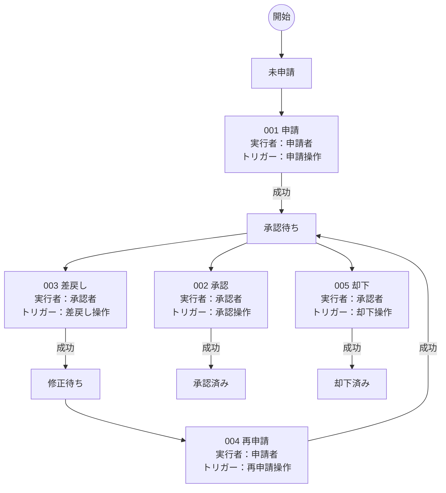

# 業務要件

## ロール一覧

| ロールID | 業務上の正式名 | 表示名 |
| --- | --- | --- |
| role.system | 業務システム | システム |
| role.requester | 申請部門の担当者 | 申請者 |
| role.approver | 申請内容を審査する責任者 | 承認者 |

## 001 申請内容の審査と再申請

### 001-00001 申請内容の受付

| 連番 | トリガー | 実行者 | ステップ名 | 処理概要 | 入出力 | アーティファクト操作 | 固定ID |
| --- | --- | --- | --- | --- | --- | --- | --- |
| 001-00001-00000 | トリガー1：申請操作 | 申請者 | 受付 | 入力元：申請ID ← id | 入力：申請ID | — | w.review/b.review_submit/p.review_submit/request |
| 001-00001-00001 | — | システム | 申請の記録 | 申請内容を受け付ける。 | — | 参照：申請ID | w.review/b.review_submit/p.review_submit/s.review_submit |
| 001-00001-00002 | — | システム | 結果返却 | 結果を返す。 | 出力：申請ID | — | w.review/b.review_submit/p.review_submit/response |

### 001-00002 審査結果の反映

| 連番 | トリガー | 実行者 | ステップ名 | 処理概要 | 入出力 | アーティファクト操作 | 固定ID |
| --- | --- | --- | --- | --- | --- | --- | --- |
| 001-00002-00000 | トリガー1：承認操作 | 承認者 | 受付 | 入力元：申請ID ← id、審査判断 ← decision | 入力：申請ID、審査判断 | — | w.review/b.review_record/p.review_record/request |
| 001-00002-00000 | トリガー2：差戻し操作 | 承認者 | 受付 | 入力元：申請ID ← id、審査判断 ← decision | 入力：申請ID、審査判断 | — | w.review/b.review_record/p.review_record/request/t.review_return |
| 001-00002-00000 | トリガー3：却下操作 | 承認者 | 受付 | 入力元：申請ID ← id、審査判断 ← decision | 入力：申請ID、審査判断 | — | w.review/b.review_record/p.review_record/request/t.review_reject |
| 001-00002-00001 | — | システム | 審査操作の記録 | 対象申請に対する審査判断（承認・差戻し・却下）を記録する。 | — | 参照：申請ID／参照：審査判断 | w.review/b.review_record/p.review_record/s.review_record |
| 001-00002-00002 | — | システム | 結果返却 | 結果を返す。 | 出力：申請ID | — | w.review/b.review_record/p.review_record/response |

### 001-00003 申請内容の受付

| 連番 | トリガー | 実行者 | ステップ名 | 処理概要 | 入出力 | アーティファクト操作 | 固定ID |
| --- | --- | --- | --- | --- | --- | --- | --- |
| 001-00003-00000 | トリガー1：再申請操作 | 申請者 | 受付 | 入力元：申請ID ← id | 入力：申請ID | — | w.review/b.review_resubmit/p.review_submit/request |
| 001-00003-00001 | — | システム | 申請の記録 | 申請内容を受け付ける。 | — | 参照：申請ID | w.review/b.review_resubmit/p.review_submit/s.review_submit |
| 001-00003-00002 | — | システム | 結果返却 | 結果を返す。 | 出力：申請ID | — | w.review/b.review_resubmit/p.review_submit/response |

## 型付き契約

| 固定ID | 名前 | コード上のキー | Python型 |
| --- | --- | --- | --- |
| a.review_id | 申請ID | application_id | str |
| a.review_decision | 審査判断 | decision | str |

## 起動定義の対応

| トリガー固定ID | 配置 | パイプライン | 許可ロール |
| --- | --- | --- | --- |
| t.review_submit | b.review_submit | p.review_submit | role.requester |
| t.review_approve | b.review_record | p.review_record | role.approver |
| t.review_return | b.review_record | p.review_record | role.approver |
| t.review_reject | b.review_record | p.review_record | role.approver |
| t.review_resubmit | b.review_resubmit | p.review_submit | role.requester |

# 業務フロー図

## 申請内容の審査と再申請

操作の番号は状態遷移表の連番に対応します。入出力・アーティファクト操作はパイプラインの詳細表を参照してください。
条件・対応パイプラインは状態遷移表に記載します。
業務上の宣言を図示しており、実行履歴や状態更新の実装済み範囲を示す図ではありません。

# 状態遷移

| 連番 | ワークフロー | トランジション | 実行者 | トリガー | 現在の状態 | 成功後の状態 | 条件 | パイプライン | 固定ID |
| --- | --- | --- | --- | --- | --- | --- | --- | --- | --- |
| 001 | 申請内容の審査と再申請 | 申請 | 申請者 | 申請操作 | 未申請 | 承認待ち | — | 申請内容の受付 | w.review/tr.review_submit |
| 002 | 申請内容の審査と再申請 | 承認 | 承認者 | 承認操作 | 承認待ち | 承認済み | 判断が承認で、承認権限があり、申請者本人ではない | 審査結果の反映 | w.review/tr.review_approve |
| 003 | 申請内容の審査と再申請 | 差戻し | 承認者 | 差戻し操作 | 承認待ち | 修正待ち | 判断が差戻し | 審査結果の反映 | w.review/tr.review_return |
| 004 | 申請内容の審査と再申請 | 再申請 | 申請者 | 再申請操作 | 修正待ち | 承認待ち | — | 申請内容の受付 | w.review/tr.review_resubmit |
| 005 | 申請内容の審査と再申請 | 却下 | 承認者 | 却下操作 | 承認待ち | 却下済み | 判断が却下 | 審査結果の反映 | w.review/tr.review_reject |
