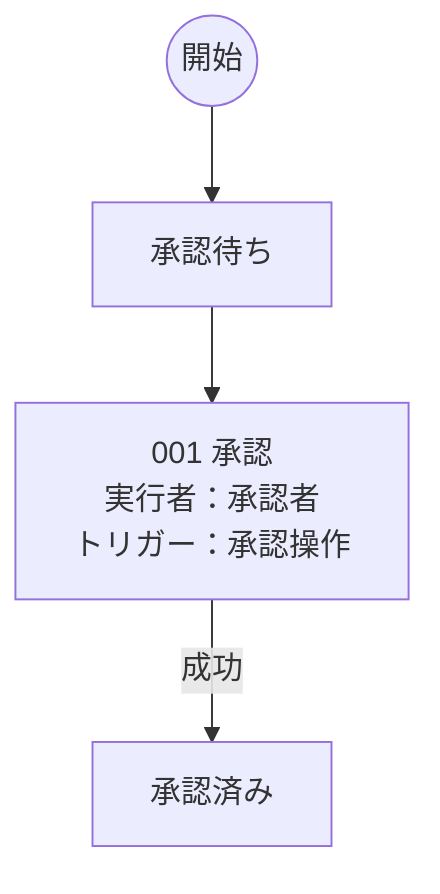

# 業務要件

## ロール一覧

| ロールID | 業務上の正式名 | 表示名 |
| --- | --- | --- |
| role.staged_system | 業務システム | システム |
| role.staged_reviewer | 申請の審査責任者 | 承認者 |

## 001 申請の準備と承認確定

### 001-00001 申請の承認確定

| 連番 | トリガー | 実行者 | ステップ名 | 処理概要 | 入出力 | アーティファクト操作 | 固定ID |
| --- | --- | --- | --- | --- | --- | --- | --- |
| 001-00001-00000 | トリガー1：承認操作 | 承認者 | 受付 | 入力元：申請ID ← id | 入力：申請ID | — | w.staged_approval/b.staged_approve/p.staged_approval/request |
| 001-00001-00001 | — | システム | 読込み・検証 | 申請と状態を読み、承認可能であることを確認する。 | — | — | w.staged_approval/b.staged_approve/p.staged_approval/s.staged_read |
| 001-00001-00002 | — | システム | 変更の準備 | ジョブIDに申請と状態の変更を紐づけ、未確定で保存する。 | — | — | w.staged_approval/b.staged_approve/p.staged_approval/s.staged_prepare |
| 001-00001-00003 | — | システム | 一括確定 | バージョンの競合を検査し、申請と状態と確定結果をまとめて保存する。 | — | — | w.staged_approval/b.staged_approve/p.staged_approval/s.staged_commit |
| 001-00001-00004 | — | システム | 結果返却 | 終了コードとメッセージを返す。 | 出力：終了コード・メッセージ | — | w.staged_approval/b.staged_approve/p.staged_approval/response |

## 型付き契約

| 固定ID | 名前 | コード上のキー | Python型 |
| --- | --- | --- | --- |
| a.staged_id | 申請ID | application_id | str |
| a.staged_version | 申請バージョン | application_version | int |
| a.staged_state_version | 状態バージョン | state_version | int |
| a.staged_changes | 確定予定の申請内容 | proposed | str |

## 起動定義の対応

| トリガー固定ID | 配置 | パイプライン | 許可ロール |
| --- | --- | --- | --- |
| t.staged_approve | b.staged_approve | p.staged_approval | role.staged_reviewer |

## 実装対応

| 固定ID | 実装 |
| --- | --- |
| s.staged_commit | examples.prepared_approval.application.commit |
| s.staged_prepare | examples.prepared_approval.application.prepare |
| s.staged_read | examples.prepared_approval.application.read_and_validate |

ロックはEngine → LockProvider、受付認可はEngine → Principal.rolesで実行。

# 業務フロー図

## 申請の準備と承認確定

操作の番号は状態遷移表の連番に対応します。入出力・アーティファクト操作はパイプラインの詳細表を参照してください。
条件・対応パイプラインは状態遷移表に記載します。
業務上の宣言を図示しており、実行履歴や状態更新の実装済み範囲を示す図ではありません。

# 状態遷移

| 連番 | ワークフロー | トランジション | 実行者 | トリガー | 現在の状態 | 成功後の状態 | 条件 | パイプライン | 固定ID |
| --- | --- | --- | --- | --- | --- | --- | --- | --- | --- |
| 001 | 申請の準備と承認確定 | 承認 | 承認者 | 承認操作 | 承認待ち | 承認済み | — | 申請の承認確定 | w.staged_approval/tr.staged_approve |
